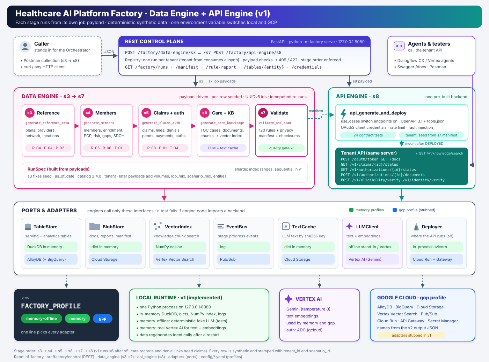

# Healthcare AI Platform Factory: Data Engine + API Engine (v1)

The **Data Engine** (stages s3–s7) and **API Engine** (stage s8) from the architecture spec, exposed as a
REST control plane. Each stage is triggered by its own job payload, exactly as the spec shows them; the
engines read nothing else (no blueprint). The Orchestrator is whoever calls the endpoints in order, for
example Postman. All four worked scenarios of the spec (S1–S4) run end to end.

All data is synthetic. Infrastructure target is GCP; locally everything runs in memory except Vertex AI.



## Quick start (Windows)

```bash
python -m venv .venv
.venv/Scripts/python -m pip install -e ".[dev]"
copy .env.example .env
.venv/Scripts/python -m factory serve
```

Control-plane docs: http://127.0.0.1:8080/factory/docs. Then call, in order:

| Step | Endpoint | Body |
|---|---|---|
| 1 | `POST /factory/data-engine/s3` | `generate_reference_data` payload |
| 2 | `POST /factory/data-engine/s4` | `generate_members` payload |
| 3 | `POST /factory/data-engine/s5` | `generate_claims_auth` payload |
| 4 | `POST /factory/data-engine/s6` | `generate_care_knowledge` payload |
| 5 | `POST /factory/data-engine/s7` | `validate_and_scan` payload |
| 6 | `POST /factory/api-engine/s8` | `api_generate_and_deploy` payload |

After s8 the tenant's API is live on the same server: Swagger at http://127.0.0.1:8080/docs, local test
credentials at `GET /factory/runs/{tenant}/credentials`.

## Scenarios S1–S4

Postman collections (import one, run the folders in order): `postman/hf-factory-s1..s4.postman_collection.json`.
They are generated from the spec payloads by `python scripts/make_postman.py`.

| Scenario | Tenant | Use cases | Size run | Contract tests |
|---|---|---|---|---|
| S1 provider-facing demo (Medicare Advantage) | `ma-demo-01` | PCS, PAS, PEV | spec size: 50k members, 50k claims | 24 |
| S2 Medicaid member pilot (Spanish, rural, caregivers) | `mdcd-pilot-02` | MBN, MPS, MPC, MAS | scaled: 20k members, 120k claims (spec 100k / 600k) | 32 |
| S3 claims denial and appeals load test | `perf-claims-03` | PCS, PAP, PPI | scaled: 15k members, 100k claims (spec 150k / 1M) | 24 |
| S4 sandbox (Commercial) | `sandbox-04` | MBN, MCI, PCS | spec size: 20k members, 120k claims | 28 |

The spec payloads are in `tests/fixtures/s1_jobs` … `s4_jobs` (extracted from the spec's own code, with its
expected outputs). The Postman collections change them in two documented ways: s4 carries the s5
`scenario_mix` (otherwise member scenarios are not generated), and S2/S3 volumes are scaled to the row limit.

**Row limit.** The memory profiles accept at most 60,000 members and 200,000 claims per run (`limits` in
`config/memory*.yaml`, about 1–1.5M rows). Larger payloads get HTTP 413 with the limit; the gcp profile has none.

## Endpoints (API Engine)

| Use case | Endpoints | Highlights |
|---|---|---|
| PCS claim status | `GET /v1/claims/{id}/status` | NPI+TIN verification, pend/denial reasons, next step |
| PAS authorization status | `GET /v1/authorizations/{id}/status`, `POST …/documents` | due times, clock pause/resume |
| PEV eligibility | `POST /v1/eligibility/verify` | cost share, retro-term and pending warnings, minimum-necessary cap |
| MBN benefits | `GET /v1/members/{id}/benefits`, `GET …/accumulators` | allowances, transport benefit, plan-document citations |
| MCI claims inquiry | `GET /v1/members/{id}/claims`, `GET /v1/claims/{id}?member_id=` | EOB math line by line, original/replacement versions |
| MPS provider search | `GET /v1/providers/search` | access standards, 1.5x widened search, access gap, telehealth |
| MPC PCP change | `PUT /v1/members/{id}/pcp` | participation, open panel, distance standard, effective next month |
| MAS scheduling | `GET /v1/providers/{npi}/availability`, `POST /v1/appointments` | blackout dates, wait standard, care gaps |
| PAP appeals | `POST /v1/claims/{id}/appeals`, `GET /v1/appeals/{id}` | deadlines, late filing, overturn → reprocessing |
| PPI payments | `GET /v1/claims/{id}/payments` | CO vs PR breakdown, recoupments, wrong-payee warning |
| Common | `POST /v1/identity/verify`, `GET /v1/knowledge/search` | |

Member-facing calls by a caregiver pass `on_behalf_of=<relationship_id>`; the authorization scope and consent
dates are enforced (rule R-06). Write endpoints (PCP change, appointment, appeal) accept `dry_run=true`; s8's
contract tests use it, so deploying never changes the validated data.

## How payloads are handled

- **A run starts at s3.** Its `root_seed`, `as_of_date`, `catalog_version` and `id_strategy` fix the run; the tenant
  comes from `consumes.alloydb` (`alloy-ma-demo-01` → `ma-demo-01`), `tenant_id` or `?tenant=`. s7 has neither, so it
  applies to the run in progress.
- **Later payloads must agree with the run** (409 with a diff otherwise); `stage_seed` must be FNV-1a of
  `"<root_seed>:<stage>"`, as in the spec (else 422). Each payload's `entities` decide what is generated.
- **Order:** s4 needs s3, s5 needs s4, s6 needs s5 (v1), s7 needs s3–s6, s8 needs a green s7 (else 409). Re-running a
  stage is idempotent and resets s7/s8.
- **Per-stage `rule_checks`:** `PASS`, `FAIL`, `PASS_PARTIAL` (sub-rules needing later tables run in s7) or `DEFERRED_TO_S7`.

Gaps in the spec payloads and how they are filled (each reported in the response's `notes`):

| Stage | Missing from the spec payload | What the engine does | Optional field to set it |
|---|---|---|---|
| s3 | LOB of each plan | Plans cycle Medicare Advantage, Commercial, Medicaid | `distributions.lob_mix` |
| s4 | Scenario mix for member scenarios | Members are baseline rows | `scenario_mix` |
| s4 | `member_accumulator` needs paid claims | Generated in s5 (rule F-03) | — |
| s5 | Claims history window | `history_months = claims × 12 / (members × 6)` | `history_months` |
| s6 | Use cases for FAQs and SOPs | Taken from the run's `scenario_mix` | `use_cases` |
| s6 | Ordering | Runs after s5 (care records and denial links need claims) | — |

## One variable switches local and cloud

`FACTORY_PROFILE` is the only setting that differs between environments:

| Profile | Tables | Blobs | Vectors | Events | LLM | Shard tasks | API runs on |
|---|---|---|---|---|---|---|---|
| `memory-offline` | DuckDB in memory | dict | NumPy | log | offline stand-in | in-process | same server |
| `memory` | DuckDB in memory | dict | NumPy | log | **Vertex AI** | in-process | same server |
| `gcp` | AlloyDB | Cloud Storage | Vertex AI Vector Search | Pub/Sub | Vertex AI | Cloud Run Job | Cloud Run + API Gateway |

Only `factory/adapters/__init__.py` maps a profile to backends; `tests/test_portability.py` fails if engine code
imports a backend library or reads the environment.

### Vertex AI (`memory` and `gcp` profiles)

`adapters/llm.py`: Gemini at temperature 0 with retries and backoff on 408/429/5xx, embeddings with
`RETRIEVAL_DOCUMENT` / `RETRIEVAL_QUERY` task types, batching, empty-response checks. Generated text goes through
the content-addressed cache, so it is reused on replay. To use it:

1. Install the gcloud CLI and run `gcloud auth application-default login`.
2. Enable the Vertex AI API; set `llm.project` (and pin `llm.model`) in `config/memory.yaml`.
3. `FACTORY_PROFILE=memory`, then `python -m factory doctor`.

### Docker

One image for every role; the command picks it. `FACTORY_PROFILE` and the s2 output are passed at run time.

```bash
docker build -t hf-factory .
```

```bash
docker run --rm -p 8080:8080 hf-factory
```

| Command | Role |
|---|---|
| `serve --host 0.0.0.0` (default) | REST control plane (Cloud Run service); honours `$PORT` |
| `task --stage s4 --tenant <id>` | one data-engine shard (Cloud Run Job task, index from `CLOUD_RUN_TASK_INDEX`) |
| `api --tenant <id>` | one tenant's business API (Cloud Run service deployed by s8) |

### GCP (`gcp` profile) — implemented, not yet run against a project

| Piece | Implementation |
|---|---|
| AlloyDB tables | AlloyDB Python Connector (pg8000, IAM auth); schema `t_<tenant>` per run; COPY into a staging table + `INSERT … ON CONFLICT` |
| Cloud Storage | objects under `gs://<bucket>/<tenant>/`; LLM text cache under `cache/text/` |
| Vector Search | stream `upsert_datapoints` with tenant/audience restricts; `find_neighbors`; chunk metadata in GCS |
| Pub/Sub | JSON events with tenant and stage attributes |
| Cloud Run Jobs | s4/s5 run as one job execution with `task_count = shards`; tasks write partial counts/checksums to GCS, merged by the control plane |
| Deployer | Cloud Run service `api-<tenant>` running `factory api`, then API Gateway with the OpenAPI document converted to 2.0 |

Resource names come from the s2 output (`config/s2_output_gcp.example.json` lists every field); start with
`factory --s2 <file> serve`. Remote tasks and the API service receive it as `FACTORY_S2_JSON`.

## What is built

- **Data engine:** all 42 catalog entities, 40 scenario recipes (PCS/PAS/PEV/MBN/MCI/MPS/MPC/MAS/PAP/PPI), appeals
  with overturn and reprocessing into replacement claims, recoupments, care-management programs and outreach.
- **Repeatability:** every value is a pure function of (seed, entity, row key, draw name); checksums are identical
  for any shard count; growing members is prefix-stable; a failed shard is retried with identical results.
- **Rules (s7):** R/T/F/C/P/A families plus foreign keys, as portable SQL (about 90–120 apply per scenario).
- **API engine:** one pre-built backend; the s8 payload switches endpoints on. OAuth2 client credentials, rate
  limit and fault injection from the payload; OpenAPI + agent tool manifest; four contract tests per endpoint.

## Known gaps

- MPA, MBP, MRX and PON (not in S1–S4) have no endpoints yet.
- The GCP adapters, Cloud Run Job executor and deployer have not been run against a live project. BigQuery
  (claims analytics) has no adapter yet. The control plane keeps run state in memory, so a restart loses it.
- API Gateway passes the Authorization header to the backend (`disable_auth`); the Cloud Run service must
  therefore allow invocation, so restrict ingress before production.
- Privacy scan checks NPI Luhn validity but not real-NPI collisions (needs a pinned NPPES snapshot).
- Reference tables are small illustrative subsets; CPT is AMA-licensed.
- Response shapes beyond the spec's four sample payloads were designed from the entity model and need review.
