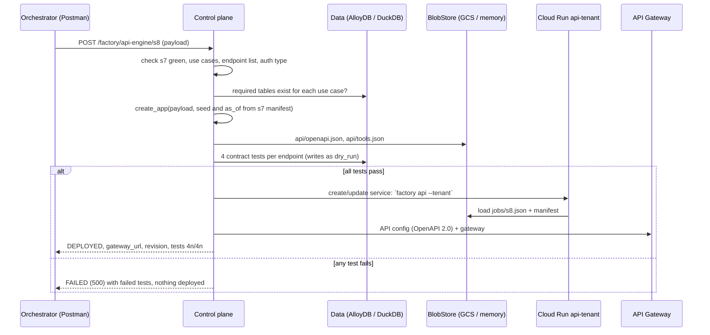

# API Engine — Design (as built, v1)

Healthcare AI Platform Factory · stage **s8** · repo `hf-factory` · status: implemented and tested in memory;
Cloud Run / API Gateway deployer implemented, not yet run against a project.

## 1. Summary

Stage s8 turns a validated dataset into a working, secured REST API for one tenant and publishes the tool definitions
agents use to call it. It is triggered by `POST /factory/api-engine/s8` with the spec's s8 payload. One pre-built
backend contains every endpoint; the payload's `use_cases` switch endpoints on. Before anything is deployed, four
contract tests per endpoint run against the real generated data.

| Measure | Value |
|---|---|
| Use cases with endpoints | 10: PCS, PAS, PEV, MBN, MCI, MPS, MPC, MAS, PAP, PPI |
| Business endpoints | 17 (15 use-case endpoints + identity verify + knowledge search), plus `POST /oauth/token` |
| Contract tests | 4 per enabled endpoint: S1 24, S2 32, S3 24, S4 28 — all passing |
| Deployment targets | in-process (local profiles) · Cloud Run service + API Gateway (gcp profile) |

## 2. Scope

**In scope:** validating the s8 payload against the catalog and the generated data; building the tenant API;
OpenAPI 3.1 and agent tool manifest; contract tests; deployment; runtime behaviour of every endpoint (verification,
scope checks, business rules, writes).

**Out of scope:** generating data (Data Engine); creating projects, networks and databases (Infra Engine);
voice/chat agents and their tool binding (stage s9); smoke tests through agents (s10).

## 3. Deploy flow (stage s8)

In the local profiles the deployer step mounts the app on the control-plane server itself, so the tenant API answers
at `http://127.0.0.1:8080/v1` and `/docs` right after s8.

## 4. The s8 payload

| Field | Rule |
|---|---|
| `job`, `stage` | `api_generate_and_deploy`, `s8` |
| `use_cases` | each must have endpoints in the catalog (else 422 `USE_CASES_NOT_IMPLEMENTED`) |
| `base_path` | e.g. `/v1` |
| `endpoints[]` | if present, must equal the catalog's endpoints for the use cases + COMMON (else 409 `ENDPOINTS_DIFFER`) |
| `consumes.alloydb` | tenant (`alloy-<tenant>`); `consumes.manifest` is cross-checked against the s7 seed |
| `auth.type` | `OAuth2 client credentials`; `auth.secret_ref` recorded |
| `rate_limit.per_client_rpm` | requests per minute per client |
| `fault_injection` | `error_rate_pct`, `latency_p95_ms` (seeded) |
| `agent_tools` | publish `tools.json` |

Pre-conditions: s7 completed with a green quality gate (else 409 `DATA_QUALITY_GATE_FAILED`), and the tables each
use case reads exist (else 409 `DATA_MISSING_FOR_USE_CASE`).

## 5. Endpoint catalog

| Use case | Endpoint | What it does | Rules and scenarios it serves |
|---|---|---|---|
| PCS | `GET /claims/{id}/status?npi&tin` | status, pend reason, denial with plain-language reason, payment, next step | C-01, PCS-01..04 |
| PAS | `GET /authorizations/{id}/status?npi&tin` | due time, review, documents outstanding, determination | T-03, PAS-01..04 |
| PAS | `POST /authorizations/{id}/documents` | marks a requested document received; clock resumes | T-03, PAS-02/03 |
| PEV | `POST /eligibility/verify` | eligibility for a date of service, plan, PCP, cost share, warnings | C-01, PEV-01..04 |
| MBN | `GET /members/{id}/benefits` | cost share, deductible status, allowances, transport benefit, citations | R-06, MBN-01..04 |
| MBN | `GET /members/{id}/accumulators` | deductible and out-of-pocket met/remaining, in and out of network | F-03 |
| MCI | `GET /members/{id}/claims` | member's claims with denial summary and version | MCI-01..04 |
| MCI | `GET /claims/{id}?member_id=` | EOB math line by line, original/replacement versions | R-07, F-06, MCI-04 |
| MPS | `GET /providers/search` | participating providers by specialty, language, accessibility, distance; access standard; widened search; access gap; telehealth | R-04, C-02, MPS-01..04 |
| MPC | `PUT /members/{id}/pcp` | validate and schedule a PCP change for the first of next month | R-05, MPC-01..04 |
| MAS | `GET /providers/{npi}/availability` | next slots skipping blackout dates; wait standard; alternatives; stale-schedule flag | T-07, MAS-01..04 |
| MAS | `POST /appointments` | book an open slot with a participating provider; notes care gaps and transport | MAS-01/02 |
| PAP | `POST /claims/{id}/appeals` | open an appeal on an appealable denial within the deadline | T-05, C-05, PAP-01..04 |
| PAP | `GET /appeals/{id}` | status, decision, late filing, reprocessing (done or awaiting) | R-07, PAP-02/03 |
| PPI | `GET /claims/{id}/payments` | payments with trace, CO vs PR breakdown, recoupments, wrong-payee warning | F-05, PPI-01..04 |
| COMMON | `POST /identity/verify` | provider NPI + TIN, or member ID + date of birth (+ ZIP) | C-01 |
| COMMON | `GET /knowledge/search` | semantic search over ACTIVE assets, filtered by audience, with citations | A-03 |

Every response carries `is_synthetic: true` and the row's `scenario_id`.

## 6. Security and compliance model

| Control | Implementation |
|---|---|
| Client authentication | OAuth2 client credentials: `POST /oauth/token` → bearer token (1 h); one client per tenant, secret derived from seed and tenant |
| Provider verification | NPI must be on the record and its TIN must match the TIN on file (PCS-04 refuses with `VERIFICATION_FAILED`) |
| Caregiver access (R-06) | member-facing calls with `on_behalf_of=<relationship_id>`: relationship verified, consent unexpired, scope covers the use case (BENEFITS, CLAIMS, PCP_CHANGE, APPOINTMENTS) |
| Minimum necessary (C-01) | members see only their own claims; eligibility capped at 20 distinct members per client per 5 minutes (PEV-04, 429 `MINIMUM_NECESSARY`) |
| Rate limit | `per_client_rpm` from the payload (429 `RATE_LIMITED`) |
| Fault injection | seeded `error_rate_pct` (503 `INJECTED_FAULT`) and slow tail; `x-fault-injection: off` disables it per call |
| Write safety (A-07) | writes are validated first; `dry_run=true` validates without writing; ids are deterministic so repeats are idempotent |
| Agent guardrails | no endpoint approves/denies authorizations, predicts appeal outcomes, changes payment instructions or gives clinical advice |

## 7. Contract tests

Each use case contributes four tests per endpoint: a happy path, a not-found or negative case, a missing token, and a
scenario case (e.g. PCS-02 pended claim, PAS-02 urgent SNF, MCI-04 claim versions, PAP-03 awaiting reprocessing,
PPI-04 wrong payee). Samples are found by scenario tag; when a scaled dataset lacks a scenario, a fallback negative
case keeps the count at four. Writes run with `dry_run=true`, so s8 never changes the validated data. A failed test
reports its HTTP status and error code; any failure blocks deployment.

## 8. Data access

Handlers contain no SQL: they call named methods of `Repository` (`api_engine/repository.py`), which is the only
place the business API's SQL lives. It uses the `TableStore` port only, with SQL in the DuckDB/PostgreSQL common
subset and `?` placeholders; coded values and limits are bound as parameters. Writes (`pcp_assignment`, `appeal_record`, `documentation_requirement`) upsert one row built with the
table's own schema. Appointments are stored as JSON objects in the BlobStore (no appointment entity in the catalog).
Knowledge search embeds the question as a query embedding and searches the `VectorIndex` with a tenant filter.

## 9. Deployment topologies

| | Local profiles | gcp profile |
|---|---|---|
| Where the API runs | mounted in the control-plane process | Cloud Run service `api-<tenant>` running `factory api --tenant <id>` |
| Front door | same server, `/v1` and `/docs` | API Gateway (OpenAPI converted to 2.0, `x-google-backend` with Authorization passed through) |
| Data | in-memory DuckDB | AlloyDB schema `t_<tenant>`, Cloud Storage, Vector Search, Vertex AI |
| Credentials | `GET /factory/runs/{tenant}/credentials` | secret in the BlobStore (Secret Manager planned) |

## 10. Error model

Errors are JSON `{"error", "message", "is_synthetic"}`.
Codes and their HTTP status are defined once in `api_engine/errors.py` (`ErrorCode`); control-plane rejections in
`control/errors.py` (`RejectCode`). Coded domain values (claim status, claim type, LOB, ...) are StrEnums in `codes.py`.

| HTTP | Codes |
|---|---|
| 401 | `INVALID_CLIENT`, `INVALID_TOKEN` |
| 403 | `VERIFICATION_FAILED`, `CAREGIVER_NOT_VERIFIED`, `CONSENT_EXPIRED`, `SCOPE_NOT_AUTHORIZED` |
| 404 | `CLAIM_NOT_FOUND`, `AUTH_NOT_FOUND`, `MEMBER_NOT_FOUND`, `PROVIDER_NOT_FOUND`, `APPEAL_NOT_FOUND`, `NO_COVERAGE` |
| 409 | `NOT_DENIED`, `NOT_APPEALABLE`, `APPEAL_EXISTS`, `DEADLINE_PASSED`, `DOCUMENT_NOT_REQUESTED`, `NOT_A_PCP`, `NOT_PARTICIPATING`, `PANEL_CLOSED`, `OUTSIDE_ACCESS_STANDARD`, `ALREADY_PCP`, `NO_ACTIVE_COVERAGE`, `SLOT_UNAVAILABLE`, `ALREADY_BOOKED` |
| 422 | `UNKNOWN_SPECIALTY`, `LOCATION_REQUIRED`, `MEMBER_IDENTIFIERS_REQUIRED`, request validation |
| 429 | `RATE_LIMITED`, `MINIMUM_NECESSARY` |
| 503 | `INJECTED_FAULT` |

## 11. Decisions and trade-offs

| Decision | Why | Cost |
|---|---|---|
| One pre-built backend; payload switches routers on | tested once, one image for every tenant (the spec pins it by digest; the deployer takes the configured image), no per-tenant code generation | every tenant's service carries all handlers |
| OpenAPI and tools derived from the running app | contract and tools can never drift from the code | response shapes beyond the spec samples are our design |
| Contract tests gate deployment | broken data or code never reaches agents | s8 takes a few seconds longer |
| `dry_run` on writes | tests and agents can confirm before acting | one more parameter per write endpoint |
| Gateway passes the client's token through | OAuth logic stays in one place for local and cloud | Cloud Run service must accept unauthenticated traffic (see gaps) |

## 12. Known gaps and next steps

1. **Multi-instance state.** Tokens, rate-limit windows and the bulk-lookup counter are per Cloud Run instance; with more
   than one instance, tokens fail (401) and limits multiply. Use signed JWTs and a shared counter (Memorystore) or API
   Gateway quotas.
2. **Secrets.** The client secret is stored in the BlobStore; write and read it from Secret Manager per `auth.secret_ref`.
3. **Ingress.** API Gateway passes Authorization through, so the Cloud Run service allows unauthenticated invocation;
   add gateway-to-service authentication and restrict ingress.
4. **Analytics.** Appeals filed through the API are written to AlloyDB but not mirrored to BigQuery.
5. **Appointments** are JSON objects in the BlobStore; add an appointment table.
6. **Use cases** MPA, MBP, MRX and PON have no endpoints yet.
7. **Cost/latency:** knowledge search calls Vertex AI for each query embedding; cache frequent questions.
8. The Cloud Run / API Gateway deployer and the OpenAPI 2.0 conversion have not been run against a live project.
