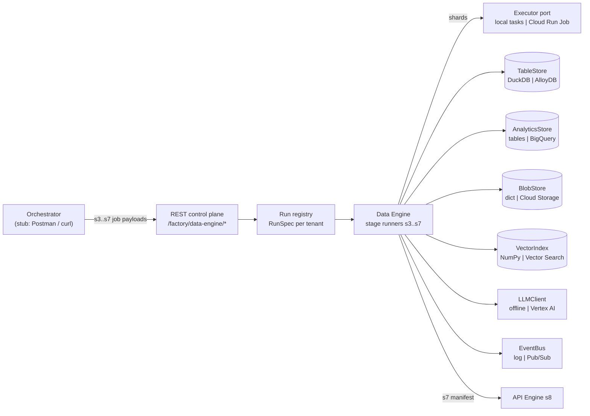
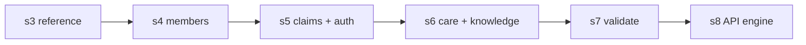

# Data Engine — Design (as built, v1)

Healthcare AI Platform Factory · stages **s3–s7** · repo `hf-factory` · status: implemented and tested in memory;
GCP adapters implemented, not yet run against a project.

## 1. Summary

The Data Engine turns five stage job payloads into a fully synthetic, rule-checked payer/provider dataset that can be
regenerated byte for byte. Each stage is one REST call (`POST /factory/data-engine/s3` … `/s7`) whose body is the job
payload from the architecture spec; the engine reads nothing else. s3–s6 generate and load data; s7 validates it,
runs a privacy scan and writes a manifest with per-entity checksums. A green s7 unlocks the API Engine (s8).

| Measure | Value |
|---|---|
| Entities generated | 42 (all of catalog 2.4.0) across Member, Provider, Claims, Authorization, Care Management, Knowledge |
| Scenario recipes | 40 (20 member-anchored, 16 claim-anchored, 4 auth-anchored) |
| Validation | 49 domain rules (R/T/F/C/P/A) + 58 foreign keys + a P-01 stamp check per entity |
| Spec scenarios run end to end | S1–S4 (S2, S3 scaled to the in-memory row limit) |
| Throughput (in memory, one laptop core) | S1 at spec size (50k members, ~815k rows) in ~10 s; S3 scaled (15k members, ~750k rows) in ~16 s |

## 2. Scope

**In scope:** reading and validating stage payloads; generating rows in dependency order; injecting scenario
recipes; LLM text for knowledge assets through a content-addressed cache; loading serving tables, the claims
analytics mirror, documents and the vector index; rule validation, privacy scan and manifest; deterministic replay.

**Out of scope:** understanding customer requests (Interpreter), choosing entities and volumes (Blueprint Engine),
run-level orchestration such as approvals, cost guard and TTL (Orchestrator), creating cloud resources (Infra Engine,
whose stage s2 output names the data stores), and serving the data to agents (API Engine).

## 3. Context

## 4. Interface

### 4.1 Endpoints

| Method and path | Purpose |
|---|---|
| `POST /factory/data-engine/{s3..s7}` | Run one stage with its job payload |
| `GET /factory/runs`, `GET /factory/runs/{tenant}` | Stage status, run settings (RunSpec), stage results |
| `GET /factory/runs/{tenant}/manifest` | s7 manifest |
| `GET /factory/runs/{tenant}/rule-report` | Every rule result and the privacy scan |
| `GET /factory/runs/{tenant}/tables/{entity}?scenario_id=&limit=` | Peek at generated rows |
| `GET /factory/runs/{tenant}/analytics/claims-summary` | Claims analytics (BigQuery in the gcp profile) |
| `DELETE /factory/runs/{tenant}` | Drop a run |

### 4.2 Job payload (spec shape; extra fields allowed)

| Field | Stages | Use |
|---|---|---|
| `job`, `stage` | all | must match the endpoint (`generate_reference_data` … `validate_and_scan`) |
| `root_seed`, `as_of_date`, `catalog_version`, `id_strategy` | s3 required, s4–s6 optional | fix the run at s3; later payloads must agree |
| `stage_seed` | s3–s6 | must equal 32-bit FNV-1a of `"<root_seed>:<stage>"` |
| `shards` | s3–s6 | task count for sharded stages (1–64) |
| `consumes.alloydb` | s3–s6 | tenant = text after `alloy-` (also `tenant_id` or `?tenant=`) |
| `entities` | s3–s6 | exactly what this stage generates |
| `volumes` | s3–s6 | providers, plans (s3); members (s4); claims, authorizations (s5); targets (s6) |
| `distributions` | s3 optional, s4 | `lob_mix`, `language_mix`, `geo_mix`, `age_by_lob`, `denial_rate` |
| `scenario_mix` | s5 (s4 optional) | scenario shares |
| `denial_rate` | s5 | claim denial rate |
| `rules` | s3–s6 | rules to check at the end of the stage |
| `llm` | s6 | informational; the profile decides the model |
| `rule_sets`, `privacy_scan`, `consumes.from` | s7 | rule families, scan options, required stages |
| `history_months`, `use_cases`, `tenant_id` | optional extensions | fill gaps in the spec payloads (§5.3) |

### 4.3 Stage result

`status`, `duration_s`, `entities[] {entity, rows, checksum}`, `rule_checks {rule: PASS | FAIL | PASS_PARTIAL |
DEFERRED_TO_S7 | NOT_CHECKED}`, `loaded_to`, `notes[]` (every accepted difference or derivation), `next_stage`.
s7 adds `validation`, `failed_rules`, `privacy_scan`, `gate`, `manifest`, `manifest_uri`, `report_uri`, `entity_count`, `total_rows`.

### 4.4 Errors

| HTTP | Codes |
|---|---|
| 409 | `STAGE_ORDER`, `RUN_SETTINGS_DIFFER`, `PAYLOAD_DIFFERS_FROM_RUN`, `MISSING_UPSTREAM_DATA`, `NO_PLAN_FOR_LOB`, `ENTITY_STAGE` |
| 413 | `PAYLOAD_TOO_LARGE_FOR_PROFILE` (in-memory row limit) |
| 422 | `WRONG_STAGE`, `WRONG_JOB`, `TENANT_REQUIRED`, `MISSING_RUN_SETTINGS`, `BAD_STAGE_SEED`, `UNSUPPORTED_CATALOG`, `UNSUPPORTED_ID_STRATEGY`, `ENTITIES_REQUIRED`, `UNKNOWN_ENTITIES`, `VOLUME_REQUIRED`, `BAD_VOLUME`, `LOB_MIX_REQUIRED`, `UNKNOWN_RULE_SETS` |
| 500 | `STAGE_FAILED` (generator error after validation) |

A rejected payload changes nothing: the run spec is restored and a rejected first s3 leaves no run behind.

## 5. Run model

### 5.1 RunSpec

There is no blueprint. A run is created by its s3 payload and extended by each later payload:

| RunSpec field | Set by |
|---|---|
| `tenant_id`, `dataset_id` | s3 (`consumes.alloydb`) |
| `root_seed`, `as_of_date`, `catalog_version`, `id_strategy` | s3, fixed for the run |
| `entities` | union of every payload's `entities` |
| `volumes` | s3 providers/plans, s4 members, s5 claims/authorizations |
| `distributions` | s3/s4 LOB mix, s4 language and geo mix, s5 denial rate |
| `scenario_mix` | s5 (or s4) |
| `history_months` | s5 (payload or derived) |
| `use_cases` | s6 (payload or derived) |
| `payload_hashes` | every stage; `data_spec_hash` = hash of s3–s6 payloads without `shards` |

### 5.2 Ordering and idempotency

The spec runs s6 in parallel with s4 after s3; v1 runs it after s5 because transition-of-care records come from
facility discharge claims (R-10) and knowledge links cover every denial code (R-11). Re-running any stage is
idempotent (same checksums) and resets s7 and s8.

### 5.3 Gaps in the spec payloads and how they are filled

| Stage | Missing | Derivation (reported in `notes`) | Optional override |
|---|---|---|---|
| s3 | LOB per plan | plans cycle Medicare Advantage, Commercial, Medicaid | `distributions.lob_mix` |
| s4 | scenario mix | members are baseline rows; member scenarios not injected | `scenario_mix` |
| s4 | `member_accumulator` needs paid claims | generated in s5 (F-03) | — |
| s5 | claims history window | `history_months = claims × 12 / (members × 6)` (D-05: 6 claims/member/year) | `history_months` |
| s6 | use cases for FAQs and SOPs | prefixes of the run's scenario ids | `use_cases` |

## 6. Stages

| Stage | Generates | Reads | Sharded | Notable logic |
|---|---|---|---|---|
| s3 | plan, provider, network_participation, practice_location, availability_schedule, provider_rating, access_standard | — | no | Luhn-valid NPIs; 8% stale directory rows and 10% stale schedules (tagged dirty data); access standards per plan × specialty × geography |
| s4 | member_demographics, family_relationship, plan_enrollment, pcp_assignment, risk_score, care_gap, sdoh_indicator | plans, PCP pools | yes (members) | LOB/age/language/geo mixes; one ACTIVE participating open-panel PCP per member (R-05); caregivers with scopes and 20% expired consents |
| s5 | 9 claim entities, 5 auth entities, member_accumulator | members, enrollments, plans, provider pools | yes (members) | claim-linked approved auths for PA codes (R-03/T-04); money math in integer cents (F-01/F-02/F-05); appeals; overturns and corrections become replacement claims (frequency 7) with reprocessing history (R-07/F-06); accumulators from final paid versions (F-03) |
| s6 | care_case, transition_of_care, care_plan, disease_program_enrollment, risk_cohort, outreach_campaign, outreach_history, 6 knowledge entities | facility claims, members, plans | no | TOC from inpatient discharges (R-10, T-06); outreach consent and AI disclosure (C-07, A-04); LLM documents → chunks → embeddings → index |
| s7 | — | everything | no | rules, privacy scan, manifest, quality gate |

## 7. Data model rules every row follows

- Primary keys are `UUIDv5(dataset_id, entity, seed, row_key)`; human keys are derived from the anchor index
  (`MBR-0000042`, `CLM-0000042-03`, `AUTH-…`, `APL-…`).
- Every row carries `is_synthetic = true`, `tenant_id` and `scenario_id` (`BASE`, a scenario id, or a dirty-data tag) — rule P-01.
- Money is `DECIMAL(14,2)` computed from integer cents; dates are `DATE`, instants `TIMESTAMP`; reserved formats for
  phones (555-01xx), emails (@example.test) and TINs (9xxxxxxxx) — P-02.

## 8. Determinism and repeatability

| Mechanism | Guarantee |
|---|---|
| Per-row counter RNG: every draw = f(seed, entity, row key, draw name), vectorised splitmix64 | data independent of shard count, worker count and order |
| No wall clock: all dates from `as_of_date` | a replay next month is identical |
| Anchor-based generation (member → claims → lines) | growing members is prefix-stable (first N members unchanged) |
| Order-independent checksum per entity (sum of row hashes mod 2⁶⁴, DuckDB pinned) | shard results add up; replays are verifiable |
| Upserts on deterministic keys | retried tasks and re-run stages never duplicate rows |
| Content-addressed LLM cache `sha256(model, prompt_version, prompt, seed)` | text replays identically when cached |

Tests prove: identical checksums for 1/3/5/7 shards, identical replay, prefix stability, re-seed changes rows but
not shape, and a shard that fails half-way is retried with identical results.

## 9. Scenario injection

- Each scenario has an **anchor** (member, claim or auth) and a recipe. Anchor rows draw a scenario from the run's
  `scenario_mix` with their own RNG stream.
- **Forced** recipes set the facts: e.g. PCS-02 pended for records, MCI-02 denied CO-197 with no auth, PAP-03 appeal
  overturned awaiting reprocessing, PPI-04 payment to another TIN, MBN-04 caregiver scoped to BENEFITS.
- **Happy-path** scenarios (PCS-01, MCI-01, PPI-01/02, PAP-01) are not forced: the tag stays only on rows that end in
  the recipe's state, so the payload's denial rate is preserved.
- A recipe that cannot fit before `as_of_date` (e.g. a late appeal in a 2-month history) falls back to `BASE`.
- Deliberate rule breaks are exempted **by tag** in the rule SQL (MCI-02 from R-03, PAP-04 from T-05, stale
  directory/schedule rows from T-07/T-07b), never by loosening the rule.

## 10. Validation (s7)

- Families: R referential (15 incl. sub-rules), T temporal (13), F financial and code integrity (12), C regulatory (3),
  P privacy (4 + one P-01 per entity), A AI guardrails (2), plus 58 foreign keys. Rules whose tables a scenario does not
  generate are skipped, so 90–120 apply per scenario.
- Rules are portable SQL (DuckDB/PostgreSQL subset); the AlloyDB adapter translates `?` placeholders and `list_contains`.
- Each stage also checks the rules its payload names; checks needing later tables are deferred to s7.
- Privacy scan: NPI Luhn validity, SSN-like patterns and non-reserved emails/phones in generated text, duplicate texts.
- Manifest: tenant, dataset, data-spec and payload hashes, seed, versions, per-entity counts and checksums, rule summary.
- **Quality gate:** zero failed rules and privacy PASS, otherwise s8 is refused.

## 11. Knowledge and LLM text (s6)

Assets per run: benefit document and plan summary per plan, provider manual, PA policy per PA code, claims
adjudication policy per denial category, FAQ library and agent SOP per use case. Text comes from the LLM port through
the cache; chunks of ≤ 350 words are embedded as documents and upserted to the vector index with audience/type/LOB
metadata. FAQ entries, agent SOPs, asset links (plans, CPT, denial codes, use cases) and a golden QA set are derived.

## 12. Execution and scaling

- s4 and s5 split the member index range into `shards` tasks. The **executor port** runs them in-process with
  retries (`local`) or as one Cloud Run Job execution with `task_count = shards` (`cloud_run_job`); remote tasks run
  `factory task --stage s4 --tenant <id>`, read the RunSpec from the BlobStore and write partial counts/checksums back.
- In-memory profiles cap a run at 60,000 members / 200,000 claims (about 1–1.5M rows); larger payloads get 413.

## 13. Storage ports and adapters

| Port | memory profiles | gcp profile |
|---|---|---|
| TableStore | DuckDB in memory | AlloyDB (connector, IAM auth), schema `t_<tenant>`, COPY + `INSERT … ON CONFLICT` |
| AnalyticsStore | queries the in-memory tables | BigQuery: claim entities loaded as Parquet → staging → `MERGE`, date-partitioned |
| BlobStore / TextCache | dict | Cloud Storage `gs://<bucket>/<tenant>/…` |
| VectorIndex | NumPy cosine | Vertex AI Vector Search, tenant/audience restricts, metadata in GCS |
| EventBus | log | Pub/Sub with tenant/stage attributes |
| LLMClient | offline stand-in or Vertex AI | Vertex AI (Gemini, embeddings) |
| Executor | in-process tasks | Cloud Run Jobs |

`FACTORY_PROFILE` is the only switch; a test fails if engine code imports a backend library or reads the environment.

## 14. Failure handling

| Failure | Behaviour |
|---|---|
| Invalid or inconsistent payload | 409/422/413, run unchanged |
| Generator exception | stage `FAILED` (500), event published, stage not marked complete |
| Shard failure | task retried (local: `max_retries`; Cloud Run: job retries); upserts keep data identical |
| Rule failure in s7 | gate red; s8 refused with the failing rules |
| LLM transient errors | retried with backoff (408/429/5xx) |

## 15. Decisions and trade-offs

| Decision | Why | Cost |
|---|---|---|
| Payload-only engines, no blueprint | matches the stage contract; the Orchestrator owns the blueprint | gaps in spec payloads need derivations (§5.3) |
| Rule-driven generation, no ML synthesizers | no real data to learn from; rules must hold exactly; determinism | realism limited to configured distributions |
| Per-row seeded RNG | shard-independent, resumable, prefix-stable | draw order per row must stay stable across versions |
| Rules enforced while generating and re-checked in s7 | generator bugs are caught (R-04 date gap was found this way) | rule logic exists twice |
| s6 after s5 | care and knowledge links need claims | less parallelism than the spec |
| One in-memory DuckDB per run locally | fast, no infrastructure | data lives as long as the server process |

## 16. Known gaps and next steps

1. GCP adapters, Cloud Run Jobs executor and BigQuery mirror have not been run against a live project.
2. Run state (RunSpec, stage results) lives in the control-plane process; persist it to the BlobStore to survive restarts.
3. Privacy scan does not check generated NPIs against a pinned NPPES snapshot.
4. Reference tables (CPT, ICD-10, NDC, CARC) are illustrative subsets; CPT needs a licence for production.
5. Replay modes beyond replay/re-seed (replay elsewhere from snapshot, evolve, catalog upgrade, repro-check job) are not built.
6. Exports in Q-05 formats (Parquet/CSV, FHIR R4, X12) and conversation seeds/audio are not built.
7. Spec follow-ups: add `scenario_mix` and LOB mix to the s3/s4 payloads; confirm s6-after-s5 with the spec owner.
